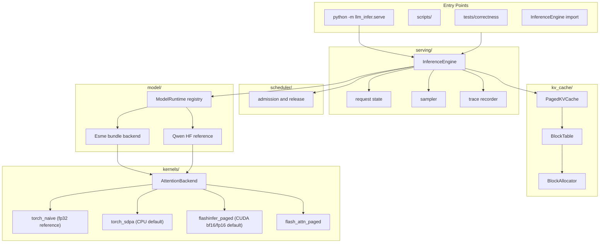

# Architecture

`llm-infer` is a Python inference library with an OpenAI-compatible HTTP server on top. The
primary path is Esme: `Esme-214M-Chat` loads from an export bundle, runs through the shared
paged-KV engine, and is checked against the full-recompute reference before speed is
reported.

## Runtime Map



## Module Ownership

| Module | Owns | Does not own |
| --- | --- | --- |
| [`model/`](../llm_infer/model/) | backend registry, capabilities, Esme bundle loader, Qwen HF reference backend | scheduling, block allocation, sampling policy |
| [`kernels/`](../llm_infer/kernels/) | causal attention implementations behind `AttentionBackend` | RoPE, GQA expansion, paging |
| [`kv_cache/`](../llm_infer/kv_cache/) | physical K/V tensor pool, block ids, scatter/gather | attention math, admission policy |
| [`scheduler/`](../llm_infer/scheduler/) | waiting queue, running set, block budget reservation | physical block allocation |
| [`serving/`](../llm_infer/serving/) | request lifecycle, decode windows, engine step loop, sampler, server integration | model weights, backend choice |
| [`tracing.py`](../llm_infer/tracing.py) | schema-versioned engine events for JSONL replay | visualizer rendering state |
| [`benchmarks/`](../llm_infer/benchmarks/) | workloads, timing, reference qualification, record validation, A/B verdicts | model execution inside the policy module |

Dependency direction stays simple:

```text
scripts/tests/server -> serving -> scheduler + model -> kv_cache + kernels
```

The main swap point is [`AttentionBackend`](../llm_infer/kernels/base.py). Model backends
prepare tensors, paging, RoPE positions, and GQA layout; attention backends compute attention.

[`InferenceEngine`](../llm_infer/serving/engine.py) owns request mutation, scheduler transitions,
KV release, and trace emission. Its methods keep admission, prefill, decode, preemption, and
completion in one lifecycle owner.

[`DecodeWindows`](../llm_infer/serving/decode_window.py) owns active windows, staged host copies,
and cached EOS tensors. It retains device matrices until the engine consumes each stage.
The engine records tokens, finishes requests, and releases KV after consumption.

The scheduler exposes `waiting` as `Collection[Request]` and `running` as `Sequence[Request]`.
These live views restrict typed callers without enforcing runtime immutability.
Scheduler methods own membership and reservation changes, including `cancel()` for aborts.

[`prepare_engine_grouped_decode()`](../llm_infer/model/runtime.py) resolves bundle-specific graph
construction. The engine owns the resulting runners, which capture against that engine's KV cache.
`resolve_backend_capabilities()` centralizes capability inference for registered and explicitly declared backends.
Optional model operations use the protocols in [`model/interface.py`](../llm_infer/model/interface.py).

## Engine Step

`InferenceEngine.step()` is the heart of the runtime:

1. Admit queued requests while the scheduler has block budget.
2. Prefill newly admitted requests, optionally in bounded chunks.
3. For already-prefilled requests, run one batched `decode_many()` forward.
4. Sample the next token for each row.
5. Finish requests that hit EOS or length caps, free their blocks, and admit more work on the
   next step.

The batch changes over time: finished requests leave, waiting requests enter, and long prompts
can prefill across several steps without fully blocking decode work.

For greedy or penalty-free sampled batches without speculation, preemption, tracing, or prefix
sharing, the engine runs decode in deferred windows. `decode_window_size` defaults to 8.
A value of 1 restores the per-step path.
Up to a window of decode steps runs per scheduler pass with sampled tokens kept on device.
The engine checks EOS after one host synchronization per window.
Bundle backends replace per-step paging bookkeeping with preallocated window buffers
(`llm_infer/model/decode_plan.py`). Outputs are token-for-token identical to the per-step
path; tokens become visible in window-sized bursts. Benchmark impact is summarized in
[benchmark.md](benchmark.md).

On CUDA, window steps replay piecewise CUDA graphs (`llm_infer/model/decode_graph.py`,
model-owned, batch padded to a bucket, KV writes and attention eager between segments). A
second tier, `InferenceEngine(grouped_decode_graphs=True)`, captures the leading
`grouped_layers` layers (four by default) *including* KV writes and FlashInfer attention per
exact batch size against the engine's own cache (`llm_infer/model/grouped_decode_graph.py`); a
window whose batch matches a captured size runs there, everything else falls back to the
piecewise buckets and then eager. The HTTP server enables it by default on CUDA bundle models
and groups all layers, because full depth is 2.9-4.6% faster per step than four layers
([findings entry 21](findings.md)); `--no-grouped-decode-graphs` skips its startup capture. The
raw engine keeps it explicit. The win depends on the batch holding its captured size, which
serving admission provides and ragged EOS-terminating benchmark drains do not
([findings entries 7 and 13](findings.md)). The runner counts its own hits
(`llm_infer_grouped_decode_steps_total` on `/metrics`) so a silent fall-through is visible.

Both graph tiers record whichever RMSNorm and RoPE kernels are active when they capture.
`llm_infer/model/fused_elementwise.py` swaps in `torch.compile` versions, and the HTTP server does
so before any warmup or capture on CUDA bf16 and fp16 bundle models. That cuts 37-44% of each
graphed decode step and adds about 40 s of compile time to a cold start
([findings entries 23 and 24](findings.md)). `--no-fused-elementwise` keeps the unfused kernels.

## Paged KV Cache

K/V rows live in fixed-size physical blocks. Each request has a `BlockTable` mapping logical
token positions to physical slots. Prefix caching shares complete prompt blocks by refcount;
generation into a shared partial block uses copy-on-write.

K/V is stored after RoPE and before GQA expansion. Decode gathers each request's paged history,
packs the ragged batch, and passes it to the active `AttentionBackend`.

## Reference Contract

Esme rows are checked against direct bundle logits/generation. The full-recompute
`PretrainBundleModel.logits()` path is the reference. Measured rows retain raw timing and tok/s;
`headline_eligible` controls whether a public consumer may report that speed.

Qwen is the independent HF reference for correctness tests, replaying frozen HuggingFace
full-recompute greedy fixtures.

Policy v2 separates fp32 reference status from direct A/B parity. bf16 differences inside the
documented 0.1-logit bound are accepted numerical choices. Larger numerical differences require
review, while malformed output and confirmed bugs fail. Exact candidate/baseline parity can support
a same-run relative claim even when both paths share a reference review. This distinction keeps
correctness checks useful without suppressing evidence about whether an optimization changed the
model's behavior.

[`reference_policy.py`](../llm_infer/benchmarks/reference_policy.py) owns `EsmeAgreement` and typed
policy records. It classifies agreement without importing model execution.
`build_system_evidence_record()` constructs records with raw timing and qualified public timing.
`headline_tokens_per_second()` validates persisted agreement and status before public tables read speed.

[`paired_ab.py`](../llm_infer/benchmarks/paired_ab.py) validates paired records and applies their
registered decision rule. The CLI in [`judge_paired_ab.py`](../scripts/judge_paired_ab.py) supplies
file input and exit status. [`check_benchmark_evidence.py`](../scripts/check_benchmark_evidence.py)
checks committed records, public tables, regenerated figures, and registered verdicts.

## Serving Surface

`python -m llm_infer.serve` builds an app from an injected `ModelRuntime`. The app exposes:

- `/v1/chat/completions`
- `/v1/completions`
- `/v1/responses`
- `/metrics`

There is no auth layer or database in this repo. The server is a local serving surface for the
engine. Production platform concerns are out of scope.

## Tracing

`InferenceEngine(trace=...)` emits schema-versioned JSONL events such as request admission,
prefill progress, decode steps, block allocation/free, preemption/resume, and request finish.
The static viewer in [../visualizer/](../visualizer/) replays those events without network
assets.

## Benchmarks

Current Esme measurements compare `llm_infer` on the Esme paged-KV path with batched HF
`generate()` and vLLM on the converted checkpoint, with naive sequential HF as the floor.

The repo's claim is narrow: a small, legible, reference-checked paged engine whose speed is
measured against an honest baseline and a mature engine on the same GPU. See
[benchmark.md](benchmark.md).

## Design References

| Technique | Role in this engine | Source |
| --- | --- | --- |
| Paged KV cache | Fixed-size blocks, per-request block tables, lower KV fragmentation, and KV sharing | PagedAttention (Kwon et al., 2023) |
| Continuous batching | Requests can enter and leave at decode-step boundaries | Orca |
| Chunked prefill | Long prompts are split so decode work can keep advancing | Agrawal et al., 2025 |
| Prefix caching | Shared prompt prefixes reuse cached K/V blocks | PagedAttention block sharing (Kwon et al., 2023) |
| Speculative decoding | Draft-and-verify shape for accepting multiple tokens safely | Leviathan et al. |
| FlashAttention-compatible backend | Fast exact attention behind a narrow kernel boundary | FlashAttention-2 |
| Trace events | Request/event observability vocabulary for replay and inspection | OpenTelemetry |

## Read Next

1. [scoping.md](scoping.md) - scope, non-goals, and the reference-before-speed rule.
2. [../llm_infer/serving/engine.py](../llm_infer/serving/engine.py) - the step loop.
3. [../llm_infer/model/pretrain_bundle.py](../llm_infer/model/pretrain_bundle.py) - Esme
   prefill/decode/full-recompute paths.
4. [../llm_infer/kv_cache/paged_kv_cache.py](../llm_infer/kv_cache/paged_kv_cache.py) - K/V
   storage and gather.
5. [benchmark.md](benchmark.md) - current measurement record.
