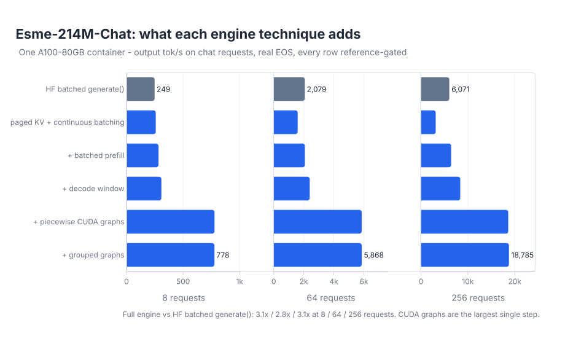
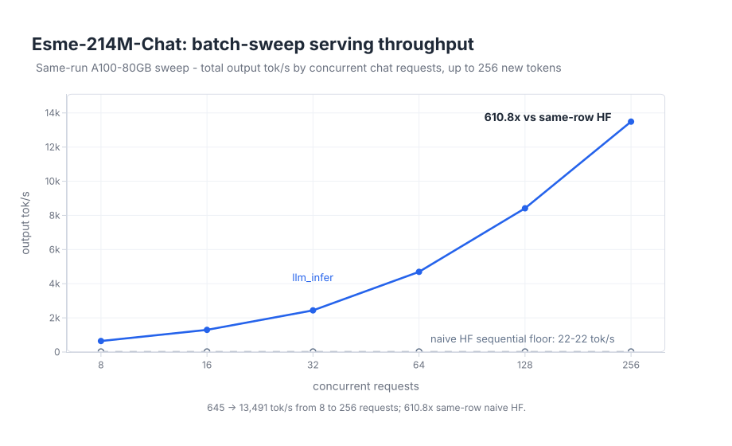

# Benchmarks

`llm-infer` keeps raw benchmark timing, but reports public headline speed only after the generated
tokens qualify under the reference policy for the same prompt and model. The public benchmark
compares:

| system | role |
| --- | --- |
| `hf_sequential` | HuggingFace `generate()` once per request, one at a time: the naive floor. |
| `hf_batched` | HuggingFace `generate()` on the whole batch, left-padded: plain static batching, the honest baseline. |
| `llm_infer` | This engine: paged KV, continuous batching, batched prefill, decode windows, and CUDA graphs over FlashInfer paged attention. |
| `vllm` | vLLM 0.24.0 on the same host: the mature-engine reference. |

The model is `Esme-214M-Chat` (214M parameters, 1024-token context), loaded from its export
bundle. The HF baseline runs a converted `Qwen3ForCausalLM` checkpoint emitted from the same
bundle and checked against the bundle reference.

Every row below passed the fp32 `PretrainBundleModel.logits()` reference gate with zero
non-tie divergences. Genuine bf16 numerical ties are accepted only after recomputing the
divergence on the fp32 reference.

## Headline

The headline compares `llm_infer` with batched HF `generate()` and with vLLM, each on one GPU in
one run. A multiple over the naive floor is kept below as batch-scaling evidence, but it mostly
measures plain batching and the host CPU: batched `generate()` alone is 4.2x faster than
sequential `generate()`, and the sequential floor measured 22.1 tok/s on one host and 59.9 tok/s
on another.

### Against HF: the ablation ladder

Run `2026-10-24`, one A100-SXM4-80GB container. Chat prompts from the headline pool, up to 256 new
tokens, real EOS, greedy, prefix caching off. Every row passed the fp32 reference gate with zero
non-tie divergences. Record: [`assets/esme-ablation-ladder.json`](../assets/esme-ablation-ladder.json).

| Concurrent requests | HF sequential tok/s | HF batched tok/s | `llm_infer` tok/s | vs HF batched |
| ---: | ---: | ---: | ---: | ---: |
| 8 | 59.9 | 249.4 | 777.7 | **3.1x** |
| 64 | — | 2,079.3 | 5,867.8 | **2.8x** |
| 256 | — | 6,070.9 | 18,784.9 | **3.1x** |

The engine rungs add one technique at a time on the same requests:



CUDA graphs are the largest step: 2.2–2.5x by median wall time. The first engine rung prefills
requests one at a time and syncs every decode step, and it runs below HF batched at 64 and 256
requests. Adding batched prefill alone brings it level with HF batched, so that deficit is serial
prefill. See
[findings entry 13](findings.md#13-ablation-ladder-what-each-technique-buys-on-one-gpu).

### Against vLLM: same host

Run `2026-10-24`, one reserved A100-SXM4-80GB host. The fp32 oracle, `llm_infer`, and vLLM 0.24.0
ran as sequential child processes with matching hostname and GPU UUID. Each request has 256 cached
prompt tokens and generates 128 tokens with EOS ignored; two warmups, median of 10 runs. The
`llm_infer` column has grouped and piecewise CUDA graphs captured at each measured batch size.
The HTTP server's default graph buckets stop at 16, so it needs `--decode-graph-buckets` to match
these rows at 64 and 256 requests. All rows are
headline-eligible. Record: [`assets/esme-vllm-same-host.json`](../assets/esme-vllm-same-host.json),
which also holds contexts 32 and 768 and the piecewise-only arm.

| Concurrent requests | `llm_infer` tok/s | vLLM tok/s | vLLM / `llm_infer` |
| ---: | ---: | ---: | ---: |
| 1 | 180.9 | 563.1 | 3.11x |
| 8 | 1,188.6 | 3,298.7 | 2.78x |
| 64 | 7,858.5 | 20,000.4 | 2.55x |
| 256 | 18,911.1 | 35,181.0 | 1.86x |

vLLM stays faster at every batch size. The gap narrows to 1.86x at 256 requests and is widest
at batch 1 (3.11x). Batch 1 has no batching effect, so batching cannot explain that gap. The two
systems use different dependency stacks (Torch 2.8 / CUDA 12.8 against Torch 2.11 / CUDA 13.0).
[Findings entry 12](findings.md#12-the-comparison-that-matters-vllm-on-the-same-host) compares
these ratios with an earlier run of the same harness.

`FlashInferPagedAttention` is the `auto` choice for CUDA fp16/bf16 Esme bundles and needs the
`gpu` extra (`uv sync --extra gpu`); the Modal harnesses bake it into the shared GPU image. To
serve or benchmark on CUDA without it, pass `--attention-backend torch_naive` or
`--attention-backend flash_attn`.

## Batch Scaling Against the Naive Floor



This curve was measured on `2026-07-10` with an earlier engine build, so its `llm_infer` tok/s are
not current. It still shows the shape of batch scaling: engine throughput grows with concurrency
while sequential HF stays flat. Current throughput is in the headline tables above and in the
[README](../README.md).

The run used one A100-SXM4-80GB (400 W) with the default CUDA Esme path: chat prompts from a fixed
pool, greedy decoding, up to 256 new tokens per request, and prefix caching off. Each `llm_infer`
row is the median of 3 measured iterations after 1 warmup. The sequential HF batch-8 anchor uses
the same repetition count. The batch-16 through batch-256 HF rows are single measured flatness
checks with no warmup, because each iteration runs every request sequentially. The committed record is
[`assets/esme-batch-curve.json`](../assets/esme-batch-curve.json), and the figure regenerates
from repo state with:

```bash
uv run scripts/plot_benchmark_curve.py
```

| concurrent requests | llm_infer tok/s | hf_sequential tok/s |
| ---: | ---: | ---: |
| 8 | 645.0 | 22.1 |
| 16 | 1,297.9 | 22.0 |
| 32 | 2,438.9 | 22.1 |
| 64 | 4,695.2 | 22.3 |
| 128 | 8,417.0 | 22.2 |
| 256 | 13,490.5 | 22.1 |

At 256 concurrent requests, the engine serves 610.8x the same-row naive-HF floor. That multiple
is not the headline, for the reasons above.

## Method

- Workload: the ladder and the batch-scaling curve use chat-templated prompts (15-41 prompt
  tokens), greedy decoding, up to 256 new tokens, EOS stopping, and prefix caching off. The vLLM
  comparison uses synthetic prompts of exactly 32, 256, or 768 tokens and 128 new tokens with EOS
  ignored, so every system decodes the same number of steps.
- Engine timing: the ladder builds one persistent engine per rung before timing and rotates the
  rung order each iteration; median of 5 runs after 1 warmup. The vLLM comparison uses a persistent
  engine; median of 10 runs after 2 warmups. The batch-scaling curve builds a fresh engine per
  iteration; median of 3 runs after 1 warmup. Graph capture is never inside a timed region.
- HF timing: HF batched uses the ladder protocol. HF sequential runs at batch 8 only, with 3
  measured iterations after 1 warmup. In the batch-scaling curve, sequential batches 16-256 use
  one measured iteration and no warmup; they check that the floor stays flat, not its spread.
- Hardware: Modal A100-80GB. The GPU SKU, clocks, and power limit are in each record. The 2026-10-24
  runs landed on A100-SXM4 (500 W); the 2026-07-10 curve ran on A100-SXM4 (400 W).
- Reference policy: fp32 full-recompute `PretrainBundleModel.logits()` is the oracle. Policy-v2
  records keep raw tok/s in every measured row and expose `headline_eligible` separately. Public
  tables use only eligible rows.
- bf16 tie rule: the Esme benchmark uses a 0.1-logit tolerance when it recomputes the first
  divergence with the fp32 oracle. This is wider than the generic 1e-3 fused-kernel fixture rule
  because the fast Esme row converts the whole model to bf16, not just attention. The headline
  pool contains 8 unique prompts; larger batches repeat them. The current evidence includes
  accepted gaps up to 0.0463 logits, but it does not establish a full error distribution up to
  0.1. Treat the threshold as an audited acceptance bound, not a measured noise percentile. A
  larger numerical difference is `review_required`, not automatically a bug; accepting it needs
  a durable diagnostic.
- Comparison rule: raw tok/s is compared only inside the same benchmark run; same-run ratios are
  the useful number. An A/B ratio also needs `exact` or explicitly reviewed `accepted_numerical`
  candidate/baseline parity and equal token counts. It does not need both paths to independently
  clear an fp32 review when they share the same continuation.

## Local Checks

These commands do not rerun GPU benchmarks. They check the local code, the committed records, the
public tables against those records, and figure regeneration:

```bash
make check
uv run scripts/check_benchmark_evidence.py
```

To rerun the GPU evidence on your own Modal account (each needs a local Esme bundle, passed with
`--bundle-path` or `ESME_BUNDLE_PATH`):

```bash
modal run scripts/modal_esme_batch_curve.py --command ladder
modal run scripts/modal_esme_vllm_baseline.py --command full
modal run scripts/modal_esme_batch_curve.py --command curve
```
